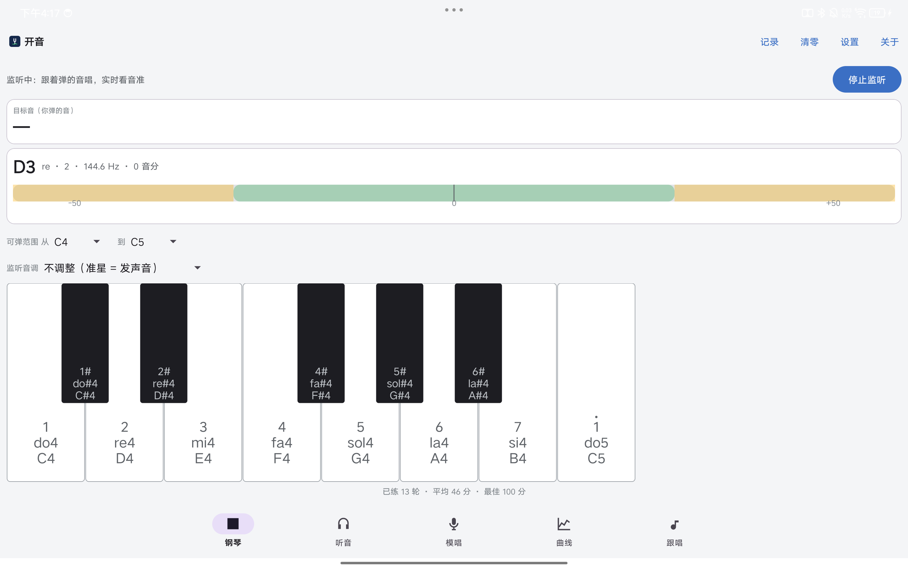

# OpenMusic 音准练习

面向音乐初学者的 Android 音准练习 App（基于 [yaque/openmusic](https://github.com/yaque/openmusic) 项目模板构建）。

> 🤖 **本项目由小米 AI Studio 制作**

## 界面预览

|                                             |  |
|---------------------------------------------|---|
|                     |  |
| **钢琴实验室**：弹琴发声 + 实时歌声识别，可弹范围 / 监听音调         | **听音选择**：选项随音域动态生成（唱名·简谱·音名），开始/结束 · 参考音 C4 · 重听 · 试听音域 |
|           |  |
| **模唱练习**：大字倒计时、音准偏差条、录音回听、盲唱模式              | **音高曲线**：时间×音高实时滚动图，每八度 7 条音线，自动跟随可开关 |
|             |  |
| **跟唱**：自定义简谱 + 起音 + 每音秒数，自动弹奏逐音检测，琴声/歌声混录回听 | **设置**：键盘标签（简谱/唱名/音名/全显）、浅色/深色/跟随系统、琴键宽长调节 |

## 功能

| 模式 | 说明 |
|---|---|
| 🎹 钢琴实验室 | 88 键横滑键盘（默认 C4–C5，起止逐键自选），弹键即发声；键上标注简谱（低音下加点/高音上加点）、唱名（do4）或音名（C4）可切；监听歌声实时判音准，同音名跨八度算唱对 |
| 👂 听音选择 | 开始/结束控制答题（每轮重新计分），**回答选项按音域动态生成**（每个音一个选项：唱名/简谱/音名），提供「参考音 C4」，结束出本轮小结 |
| 🎤 模唱练习 | 会话式（开始模唱/下一轮/结束，结束后停止计分），大字倒计时，录音可「回听」，同音名跨八度算唱对 |
| 📈 音高曲线 | 实时监听：横轴时间（12 秒滚动）、纵轴音高（音名刻度），音域自选默认全域，实时提示当前唱的音 |
| 🎵 跟唱 | 自定义简谱（1–7，0 休止）+ 起音 + 每音秒数，自动弹奏并逐音检测跟唱；弹出的音与歌声混合录制可回听；默认模板：C4 起 · 1234567654321 · 3 秒/音 |

全局设置：键盘标签（简谱加点/唱名 do4/音名 C4）、外观（浅色/深色/跟随系统）、琴键宽长（20–120dp）；所有音域持久保存；「计分记录」统一查看钢琴/听音/模唱/跟唱成绩，各页可「重新计分」。

## 技术要点

- Kotlin + AGP 9.3.3（基准模板自带 Kotlin 支持），Material3 深色主题
- 钢琴音色：运行时**加法合成**（谐波叠加 + 指数衰减包络），无需音频资源，离线可用
- 音高识别：自研 **YIN 基频检测**（`audio/PitchEngine.kt`，纯 Kotlin，JVM 单测覆盖）
- 麦克风监听：`AudioRecord` 44.1kHz → YIN → 中值平滑 → 音名/音分换算（`music/Note.kt`）
- 音准度量：`cents = 1200·log2(f唱/f目标)`，±25 cents 内判「很准」

## 构建

```bash
export JAVA_HOME=~/opt/jdk-21.0.12.1+1
export ANDROID_HOME=~/android-sdk
./gradlew assembleDebug        # 产出 app/build/outputs/apk/debug/app-debug.apk
./gradlew testDebugUnitTest    # 运行音分换算 / YIN 检测单测
```

## 权限

- `RECORD_AUDIO`（运行时申请）：用于歌声监听与模唱识别
- 建议佩戴耳机练习，避免琴声干扰歌声识别（模唱模式已采用「先放音→静音→再唱」时序规避串音）

## 文档

- [docs/需求分析与设计.md](docs/需求分析与设计.md)：需求补全、功能规格、架构与验收标准

---

**Credits**：本项目由 🤖 小米 AI Studio 制作 · 基于开源项目 [yaque/openmusic](https://github.com/yaque/openmusic) 构建
